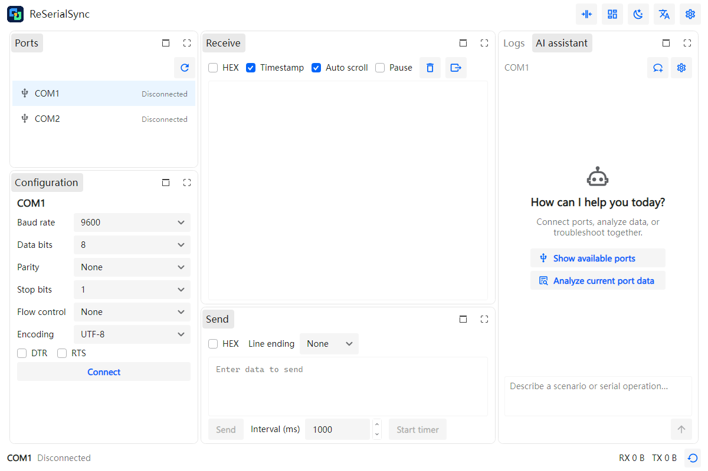

# ReSerialSync

A dockable serial debugging workbench rebuilt with Avalonia 12 and .NET 10 from my existing
[SerialSync](https://github.com/0use-TE/SerialSync) Blazor Hybrid application.

[中文](README.md) · [Migration write-up](docs/migration.en.md) · [Downloads and runtime instructions](docs/releases.md) · [Before / after](docs/screenshots.md)



Screenshot: Avalonia Headless + Skia, simulated ports. Windows x64 and Linux x64 Native AOT outputs exist;
Linux startup has been observed under WSL 2 / WSLg. Native Linux and macOS hardware communication remain unverified.

## Features

- Independent concurrent serial sessions, per-port parameters, drafts, counters and timed transmission.
- Text/HEX, UTF-8/ASCII/Latin-1, configurable line endings, receive timestamps and export.
- Dockable port list, configuration, receive, send, logs and AI panels; full and compact workspaces.
- Light/dark themes, Chinese/English localisation and automatic layout/configuration persistence.
- Serilog file logging with per-port display, keyword and severity filtering.
- Optional DotKernel AI assistant with serial context, parameter configuration and connection tools.
  Prepared payloads remain in the editor for the user to send.

AI settings accept an OpenAI-compatible endpoint, model and API key. Keys are stored as plaintext locally;
application releases contain no credentials. Serial debugging works without an AI service.

## Build and verify

Install the .NET 10 SDK, then:

```sh
dotnet run --project ReSerialSync/ReSerialSync.Desktop -c Debug
dotnet run --project ReSerialSync/ReSerialSync.Tests -c Debug
```

Native AOT publishing requires the platform's native compiler toolchain. Build separately on each target OS;
see [release instructions](docs/releases.md). The test suite uses simulated serial devices and AI responses.
It does not replace hardware tests.

The [ESP32 example](SerialSyncLowerComputer/README.md) provides an auto-reply firmware for real-device testing.
Browser and mobile entry points do not yet provide serial backends.

## Migration summary

The original repository dates to March 2025. Between October 1 and October 8, 2026, I rebuilt the UI
from Razor/CSS/WebView to AXAML and MVVM, redesigned the workspace for multiple ports, added automatic persistence
and integrated AI. My retrospective estimate is about eight hours of active effort, excluding prior library development.
Most code was AI-assisted; I directed requirements, reviewed the interface and tested the result.

The hardest issues were Native AOT event binding, Linux dependency compatibility and device permissions,
plus preserving stream boundaries and line endings. The [full write-up](docs/migration.en.md) records both
the implementation and the limits of current platform verification.

## Author and licence

Ouse · [Website](https://0use.net) · [GitHub](https://github.com/0use-TE)

Author of Crystal.Avalonia, GOZA.Dock and DotKernel. ReSerialSync is released under the [MIT licence](LICENSE).
Dependencies retain their own licences. See [third-party notices](docs/third-party-notices.md).
