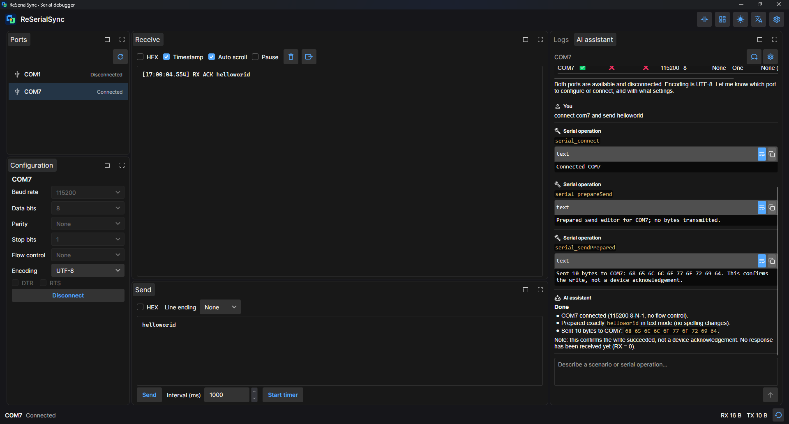

# ReSerialSync

[English](README.md) · [迁移文章](docs/migration/README.zh-CN.md) · [文档](docs/README.zh-CN.md)

使用 Avalonia 12 和 .NET 10 重写的串口调试工具，是 [SerialSync](https://github.com/0use-TE/SerialSync) 的升级版。
提供独立串口会话、可停靠布局和 AI 助手，已在 Windows 与原生 Arch Linux 上完成 ESP32 实机收发。



## 项目与迁移文章

- 项目仓库：[github.com/0use-TE/ReSerialSync](https://github.com/0use-TE/ReSerialSync)
- 英文迁移文章：[docs/migration/README.md](https://github.com/0use-TE/ReSerialSync/blob/main/docs/migration/README.md)
- 中文迁移文章：[docs/migration/README.zh-CN.md](https://github.com/0use-TE/ReSerialSync/blob/main/docs/migration/README.zh-CN.md)

文章包含界面重写、Native AOT、体积、内存、启动测量、AI 开发过程和硬件实拍。
英文版由 AI 从中文翻译，可能有不自然的措辞。

## 功能

- 多串口同时连接，每个设备独立保存参数、发送草稿、计数与接收缓冲。
- 文本/HEX、UTF-8/ASCII/Latin-1、可选行尾和定时发送。
- Dock 面板自由调整、布局自动保存、精简模式。
- 明暗主题、中英文切换和 Material Icons。
- Serilog 文件日志，支持关键词与等级过滤。
- DotKernel AI 场景与工具调用。明确要求发送时，发送编辑器当前内容一次；只准备内容时不会发送。

设置中填写兼容 OpenAI 的地址、模型和 API key，key 明文保存在本地。普通串口功能不需要 AI。

## 运行与构建

需要 .NET 10 SDK：

```powershell
dotnet run --project ReSerialSync/ReSerialSync.Desktop
dotnet run --project ReSerialSync/ReSerialSync.Tests
```

Windows 在 Windows 上构建，Linux 在 Linux 上构建，分别使用 `scripts/publish.ps1` 和 `scripts/publish-linux.sh`。
系统依赖与公开预览版见[运行说明](docs/zh-CN/releases.md)。当前源码包含 10 月 9 日的 AI 发送修复，此前公开预览版尚未包含。
Windows 与 Linux AOT 均已构建；因没有 Mac，暂未测试 macOS。浏览器与移动端串口实现尚未完成。

模拟串口、模拟 AI 和 Avalonia Headless 验证共 **127 项通过**。
仓库附有 [ESP32 自动回复示例](SerialSyncLowerComputer/README.md)，用于实机测试。

## 库与作者

[Crystal.Avalonia](https://github.com/0use-TE/Crystal.Avalonia)、[GOZA.Dock](https://github.com/0use-TE/GOZA.Dock)、[DotKernel](https://github.com/0use-TE/DotKernel) 是我开发的库。
社区组件包括 Semi.Avalonia、Material Icons、LiveMarkdown.Avalonia 和 Serilog，详见[依赖声明](docs/zh-CN/third-party-notices.md)。

Ouse / 0use-TE · [个人主页](https://0use.net) · [GitHub](https://github.com/0use-TE)

[MIT 许可证](LICENSE)。感谢 Avalonia 团队、社区和开源组件作者，一起加油！
