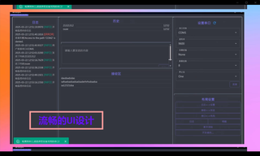
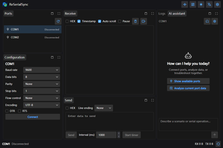
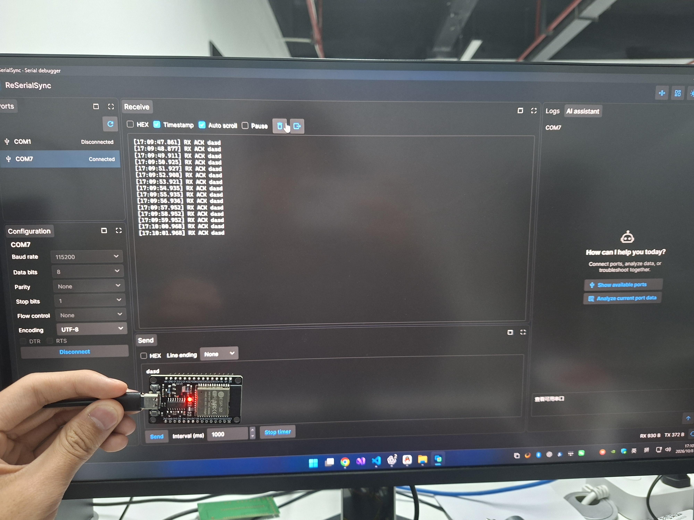
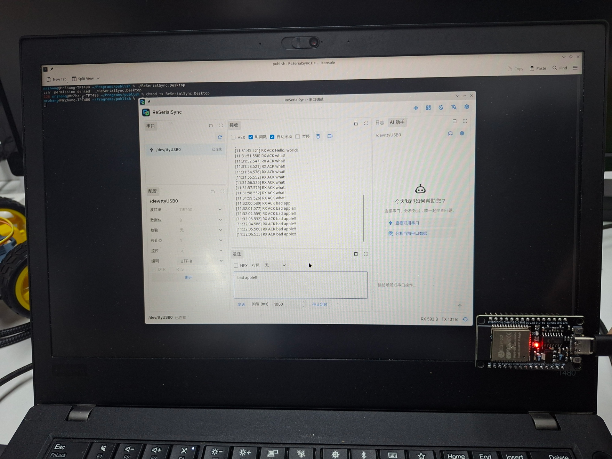
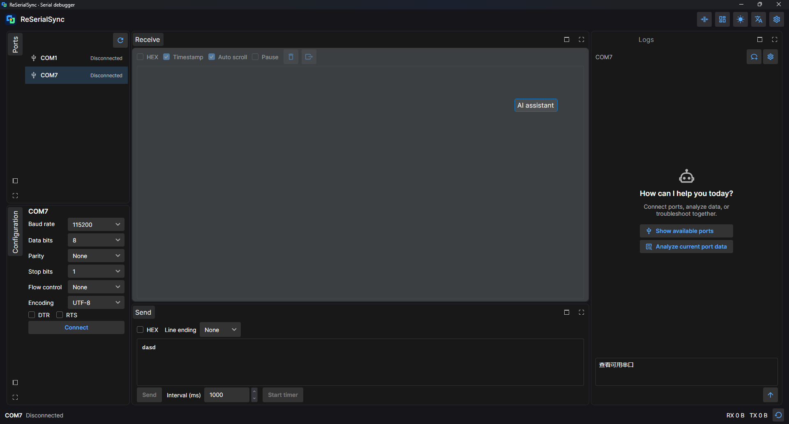
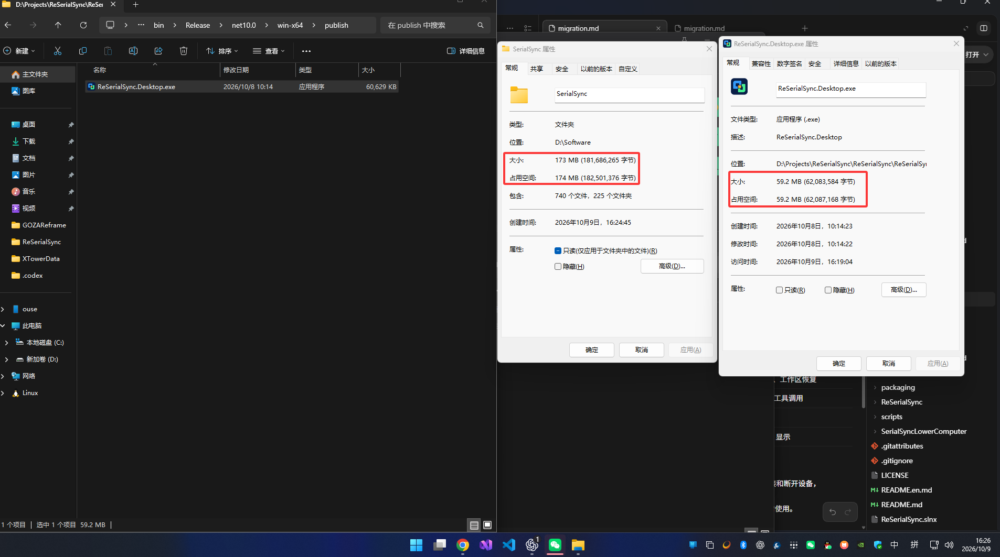
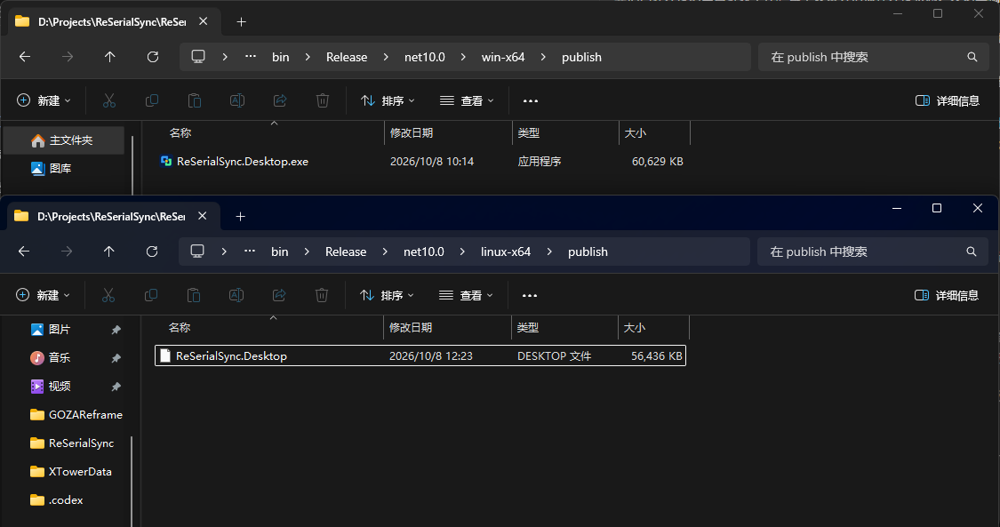
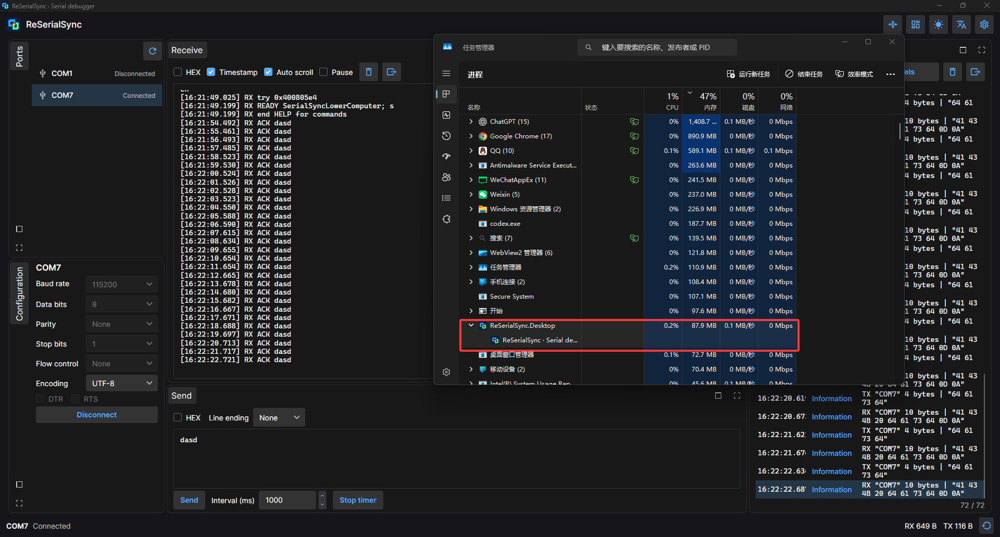
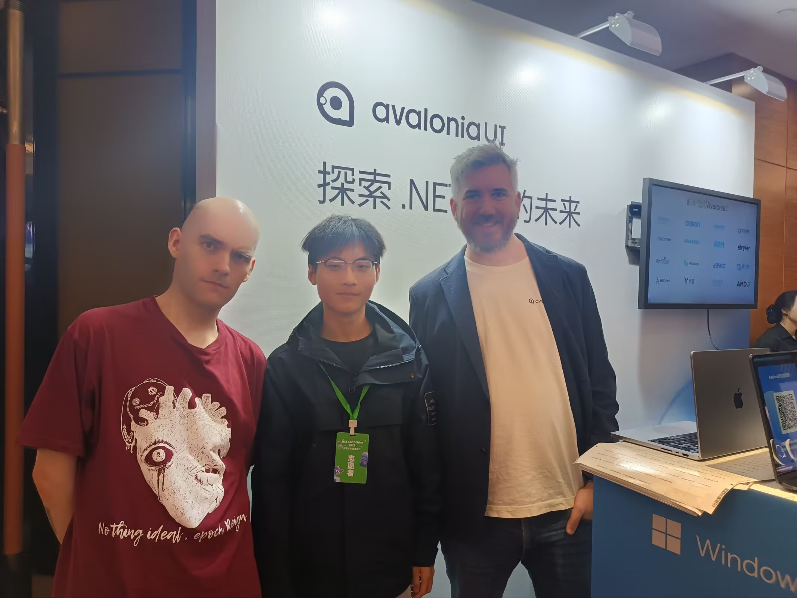

# From SerialSync to ReSerialSync: rebuilding my serial tool with Avalonia

[English](README.md) · [中文](README.zh-CN.md)

> I wrote this article in Chinese and used AI to translate it into English. My English is limited, so some wording may sound unusual. Please refer to the [Chinese original](README.zh-CN.md) if anything is unclear.

[SerialSync](https://github.com/0use-TE/SerialSync) is a serial debugging tool I built in 2025 with .NET MAUI Blazor Hybrid, MudBlazor and NLog.
I have now rewritten it with [Avalonia 12](https://avaloniaui.net/) and .NET 10, and named it ReSerialSync.

I wanted it to work on Windows and Linux, handle several devices more comfortably, and be easy to share and run.
The rewrite took place from October 1 to 8, 2026, with about eight hours of active involvement. AI wrote most of the code; I handled requirements, UI revisions and hardware testing.
The time is my retrospective estimate and excludes earlier work on my libraries.

## Before and after

| Original SerialSync | ReSerialSync |
| --- | --- |
|  |  |
| MAUI Blazor Hybrid, MudBlazor, NLog | Avalonia, Semi.Avalonia, GOZA.Dock, Serilog |

The original image comes from the old repository's demonstration video. The Windows and Arch Linux photographs below show the new application in use.

## 1. Cross-platform: the same code working with real devices on two systems

This was my main reason for choosing Avalonia. Windows and Linux share the AXAML views, view models, serial sessions and configuration code.
I did not have to write a new interface for Linux.

### Windows

The ESP32 connects through COM7 at 115200 / 8N1. The application sends `dasd` every 1000 ms, and the device keeps replying with `ACK dasd`.

### Arch Linux

On a native Arch Linux desktop, the application connects to `/dev/ttyUSB0` at 115200 / 8N1 with UTF-8.
The send interval is also 1000 ms. The receive panel shows consecutive `ACK Hello, world!`, `ACK what!` and `ACK bad apple!!` replies.
The port names differ between systems, but the interface and workflow are the same.

I also ran the Linux version under WSL 2 / WSLg and worked through USB attachment and serial permissions.
Unfortunately, I do not have a macOS device, so I have not been able to test building, running or serial communication on macOS.

## 2. Avalonia UI: from a page to an adjustable workspace

The old version used Blazor pages. The rewrite separates ports, configuration, reception, transmission, logs and AI chat into panels arranged with GOZA.Dock.
Panels can be docked and resized, and the layout saves automatically. Compact mode keeps just the panels needed for serial debugging.

Separating the port list from configuration means that more devices only require scrolling the list.
Selecting a port shows its own parameters and data while other connected ports keep working.
Each device retains its own connection state, send draft, receive buffer and counters.

Light and dark themes use Semi.Avalonia and GOZA.Dock resources. Material Icons make the toolbar more compact.
Languages can be switched at any time, and settings offer modern or classic dock tabs.

The AI assistant is being dragged towards the receive panel. The shaded area previews the docking position.
Panels can be rearranged or grouped into tabs, and the saved layout returns on the next launch.

The changes live in AXAML, styles and bindings, with most interactions handled by view-model commands.
Avalonia supplies the cross-platform UI foundation; Semi.Avalonia and GOZA.Dock supply themes and docking.

## 3. Native AOT: share the executable and run it

Windows x64 and Linux x64 Native AOT versions have been produced.
The Windows version is a single file: send someone the exe and they can run it without installing .NET or extracting an archive.
Linux system dependencies are listed in the [runtime instructions](../en/releases.md).

AOT also exposed a real issue. Crystal.Avalonia's reflection-based event-name lookup prevented startup scanning after publishing.
Routed events now resolve through Avalonia's event registry, with explicit RoutedEvent bindings also supported.
The application no longer needs DynamicDependency workarounds. Ordinary CLR events retain a reflection fallback with runtime limitations.

### Published size

| Item | Original Blazor Hybrid | Windows single-file AOT rewrite |
| --- | --- | --- |
| Size recorded in the screenshot | 173 MB, excluding separately installed runtimes | 59.2 MB, about 65.8% smaller |
| Files | Installation directory with 740 files | One exe |
| Sharing | Install the application and its required environment | Send the exe and run it |

| Windows x64 | Linux x64 |
| --- | --- |
| 60,629 KB | 56,436 KB |

## 4. Memory and startup

The rewrite draws its UI with Avalonia, removes the WebView and uses Native AOT publishing.

### Memory

With COM7 connected, one-second timed sends, incoming replies and log updates, Task Manager shows **87.9 MB**.
The original application's memory usage under the same conditions still needs to be measured.

### Startup

Both applications were launched five times consecutively on the same Windows computer.
Timing starts at process creation and ends when the main window is visible and responds to Windows messages.

| Run | SerialSync | ReSerialSync AOT |
| --- | ---: | ---: |
| 1 | 450.7 ms | 131.1 ms |
| 2 | 437.3 ms | 140.9 ms |
| 3 | 435.0 ms | 133.9 ms |
| 4 | 442.9 ms | 136.7 ms |
| 5 | 458.6 ms | 132.4 ms |
| Median | **442.9 ms** | **133.9 ms** |

The rewrite's median was **133.9 ms**, about **69.8% shorter**. Consecutive launches can benefit from caching; asynchronous loading after the window appears is excluded.
[Measurements](../media/startup-benchmark.json) · [Script](../media/startup-measure.ps1)

## 5. My libraries and the AI assistant

Crystal.Avalonia, GOZA.Dock and DotKernel are libraries I develop. Other features use community components:

| Component | Purpose |
| --- | --- |
| [Crystal.Avalonia](https://github.com/0use-TE/Crystal.Avalonia) | View/view-model organisation, view location and event-to-command binding |
| [GOZA.Dock](https://github.com/0use-TE/GOZA.Dock) | Docking, tab styles and workspace restoration |
| [DotKernel](https://github.com/0use-TE/DotKernel) | AI chat, serial context and tool calls |
| [Semi.Avalonia](https://github.com/irihitech/Semi.Avalonia) / [Material.Icons.Avalonia](https://github.com/AvaloniaUtils/Material.Icons.Avalonia) | Themes and icons |
| [LiveMarkdown.Avalonia](https://github.com/DearVa/LiveMarkdown.Avalonia) | Markdown display for AI replies |
| [System.IO.Ports](https://www.nuget.org/packages/System.IO.Ports) / [Serilog](https://github.com/serilog/serilog) | Serial communication and file logging |

The assistant reads the current serial context, refreshes and selects ports, configures parameters, and connects or disconnects devices.
It can fill the send editor and, when explicitly asked to send, transmit its contents once using the current mode, encoding and line ending.
Preparation alone does not transmit. Timed sending is started through the UI.
Users enter an endpoint, model name and API key in settings. Serial debugging works without AI; the key is stored as plaintext locally.

This example uses DeepSeek. After `connect com7 and send helloworid`, the assistant connects COM7, prepares the content and sends 10 bytes.
The receive panel then shows the device's `ACK helloworid` reply.

## 6. Developing Avalonia with AI

My process was simple: describe a feature, let AI write it, then open the application and check the result.
An awkward port selector became a separate dock panel. Crowded buttons became icons. Excessive spacing was adjusted.
The AI chat, settings, themes and language switching grew through the same iterations.

AXAML, styles and view models provide clear places to make changes.
I could ask to separate a panel, save a setting automatically or replace an event handler with a command, then check the UI and behaviour.
For me, developing Avalonia with AI went smoothly. Publishing and hardware environments took more troubleshooting.

### Issues encountered

1. **Events stopped firing after AOT publishing.** Crystal.Avalonia's routed-event lookup was fixed as described above.

2. **Linux compiled but failed to start.** Tmds.DBus.Protocol 0.95.1 removed Connection, which Avalonia 12.0.0 required.
   I used the compatible 0.92.0 and installed libICE and Chinese fonts.

3. **A port was visible but could not be opened.** After USB attachment through usbipd, the Linux user still needed read/write access to the device file.

4. **Extra blank lines appeared in reception.** The formatter added another newline after the device's own line ending.
   The fix also checked split CRLF, partial UTF-8 and blank lines intentionally sent by the device.

The October 8 suite completed 122 checks for concurrent sessions, unplug/replug, binding, HEX, split UTF-8, themes, localisation, AI tools and persistence.
After adding explicit AI sending on October 9, all **127 checks** passed, including exact bytes, disconnected ports, invalid HEX, cancellation and write failures.
These checks use simulated serial ports, simulated AI and Avalonia Headless. Real device communication is shown in the Windows and Arch Linux photographs.
The repository also contains an ESP32 auto-reply example for reproducing the tests.

## How I met Avalonia

As a student, I received licence support through Avalonia's student programme.
I also took this photograph at the Avalonia booth during .NET Conf in 2025.

Later, I was lucky enough to win a Huawei MatePad Edge in an official Avalonia giveaway.

From learning Avalonia to writing libraries and rebuilding this tool, I now have a cross-platform application for everyday use.
Next, I will complete the original application's memory comparison and keep improving the tool while debugging real devices.

Thank you to the Avalonia team, the community and the authors of the open-source components. Let's keep building useful cross-platform applications together!
