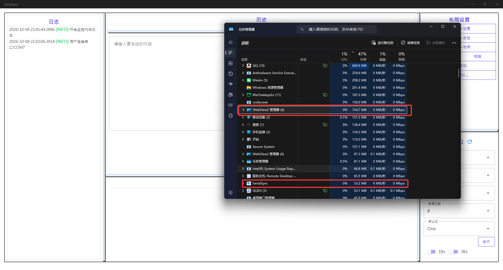

# 从 SerialSync 到 ReSerialSync：用 Avalonia 重写我的串口工具

[English](README.md) · [中文](README.zh-CN.md)

[SerialSync](https://github.com/0use-TE/SerialSync) 是我在 2025 年做的串口调试工具，使用 .NET MAUI Blazor Hybrid、MudBlazor 和 NLog。
这次我用 [Avalonia 12](https://avaloniaui.net/) 和 .NET 10 重写了它，取名 ReSerialSync。

我希望它能在 Windows 和 Linux 上使用，界面更适合同时调试多个设备，发布后也方便直接运行。
重写从 2026 年 10 月 1 日到 8 日，主动投入大约 8 小时。代码基本交给 AI 写，我负责需求、界面调整和硬件测试。
这个时间是我的回顾估算，不包含此前开发几个库的时间。

## 新旧界面

| 旧版 SerialSync | 新版 ReSerialSync |
| --- | --- |
|  |  |
| MAUI Blazor Hybrid、MudBlazor、NLog | Avalonia、Semi.Avalonia、GOZA.Dock、Serilog |

旧版图片取自原仓库的演示视频。新版的实际使用情况可以看下面 Windows 和 Arch Linux 的实拍。

## 1. 跨平台：一套代码，在两种系统上调试真实设备

这是我选择 Avalonia 最看重的一点。界面使用 AXAML 和 MVVM，Windows、Linux 共享视图、视图模型、
串口会话和配置代码。移到 Linux 后，不需要重新做界面。

### Windows

ESP32 连接到 COM7，参数为 115200、8N1。软件每隔 1000 ms 发送一次 `dasd`，
下位机持续返回 `ACK dasd`，接收区正常显示。

### Arch Linux

在原生 Arch Linux 桌面上，同一个工具连接 `/dev/ttyUSB0`，使用 115200、8N1、UTF-8。
定时发送间隔也是 1000 ms，接收区能看到连续的 `ACK Hello, world!`、`ACK what!` 和 `ACK bad apple!!` 回复。
Windows 和 Linux 的端口名称不同，操作界面和使用方式相同。

我也在 WSL 2 / WSLg 下运行过 Linux 版本，处理了 USB 接入和串口权限问题。
很遗憾，我没有 macOS 设备，暂时无法测试 macOS 的构建、运行和串口通信。

## 2. Avalonia 界面：从一个页面，改成可调整的工作区

旧版使用 Blazor 页面。新版把串口列表、当前配置、接收、发送、日志和 AI 助手拆成独立面板，
通过 GOZA.Dock 组织布局。面板可以停靠、调整大小，布局自动保存；切换到精简模式后，只保留串口调试需要的区域。

串口列表和配置分开后，设备多了也只需要滚动列表。点击某个串口，就显示它自己的参数和收发内容，
其他已经连接的串口继续工作。每个设备分别保存连接状态、发送草稿、接收缓冲和计数。

明暗主题使用 Semi.Avalonia 和 GOZA.Dock 的主题资源，顶部操作换成 Material Icons。
中英文可以随时切换，设置中还能选择 Dock 标签的现代或经典样式。

图中正在把 AI 助手拖向接收区域，灰色区域提示停靠位置。串口、配置、收发、日志和 AI 面板
可以按需要重新排列，也可以合并为标签；重新打开软件时会恢复保存的布局。

这些调整都在 AXAML、样式和绑定里完成，主要交互通过命令放在视图模型中。
## 3. Native AOT：发布后直接运行

新版支持 Native AOT，已发布 Windows x64 和 Linux x64 版本。
Windows 是单文件：把 exe 发给别人即可运行，不用安装 .NET 运行时，也不用解压。
Linux 的系统依赖见[发布说明](../zh-CN/releases.md)。

AOT 也是这次重写中实际遇到的问题。Crystal.Avalonia 原来的事件名查找依赖反射，
发布后启动扫描没有执行。修复后，路由事件通过 Avalonia 的事件注册表查找，也支持显式指定 RoutedEvent，
应用里的 DynamicDependency 因此可以去掉。普通 CLR 事件仍保留反射分支，有相应的运行时限制。

### 发布体积

| 项目 | 旧版 Blazor Hybrid | 新版 Windows 单文件 AOT |
| --- | --- | --- |
| 体积（上图记录） | 173 MB，不含另外安装的运行时 | 59.2 MB，减少约 65.8% |
| 文件形式 | 安装目录，740 个文件 | 一个 exe |
| 使用方式 | 安装应用及所需运行环境 | 直接发送 exe，打开即用 |

| Windows x64 | Linux x64 |
| --- | --- |
| 60,629 KB | 56,436 KB |

## 4. 内存与启动速度

新版用 Avalonia 绘制界面，去掉了 WebView，并采用 Native AOT 发布。

### 内存

| 版本 | 主进程 | WebView2 进程组 | 合计 |
| --- | ---: | ---: | ---: |
| 旧版 Blazor Hybrid | 53.2 MB | 154.7 MB | **207.9 MB** |
| 新版 Avalonia AOT | 87.9 MB | 无 | **87.9 MB** |

旧版合计按截图中标出的 WebView2 进程组计算，进程归属待确认。旧版连接 COM7；新版每秒定时收发并更新日志，两张截图的运行状态不同。

### 启动时间

同一台 Windows 电脑，各连续启动 5 次；测量从创建进程到窗口可见并响应消息的时间。

| 次数 | 旧版 SerialSync | 新版 ReSerialSync AOT |
| --- | ---: | ---: |
| 1 | 450.7 ms | 131.1 ms |
| 2 | 437.3 ms | 140.9 ms |
| 3 | 435.0 ms | 133.9 ms |
| 4 | 442.9 ms | 136.7 ms |
| 5 | 458.6 ms | 132.4 ms |
| 中位数 | **442.9 ms** | **133.9 ms** |

新版中位数 **133.9 ms**，比旧版缩短约 **69.8%**。连续启动有缓存，不计窗口出现后的异步加载。
[测量记录](../media/startup-benchmark.json) · [脚本](../media/startup-measure.ps1)

## 5. 自己的库与 AI 助手

Crystal.Avalonia、GOZA.Dock 和 DotKernel 是我开发的库，其他功能使用社区组件：

| 组件 | 用途 |
| --- | --- |
| [Crystal.Avalonia](https://github.com/0use-TE/Crystal.Avalonia) | Views / ViewModels 组织、视图定位、事件转命令 |
| [GOZA.Dock](https://github.com/0use-TE/GOZA.Dock) | 停靠布局、标签样式、工作区恢复 |
| [DotKernel](https://github.com/0use-TE/DotKernel) | AI 对话、串口场景和工具调用 |
| [Semi.Avalonia](https://github.com/irihitech/Semi.Avalonia) / [Material.Icons.Avalonia](https://github.com/AvaloniaUtils/Material.Icons.Avalonia) | 主题和图标 |
| [LiveMarkdown.Avalonia](https://github.com/DearVa/LiveMarkdown.Avalonia) | AI 回复的 Markdown 显示 |
| [System.IO.Ports](https://www.nuget.org/packages/System.IO.Ports) / [Serilog](https://github.com/serilog/serilog) | 串口通信和文件日志 |

AI 助手可以查看当前串口场景，刷新设备、选择串口、配置参数、连接和断开设备，
也能把待发送内容填进编辑器。明确告诉它“发送”时，会按当前文本或 HEX 模式、编码和行尾发送一次，
并返回实际写入结果；只要求准备内容时不会发送。定时发送仍由用户在界面开启。
设置中填写模型地址、模型名称和 API key；不用 AI 时，串口功能照常使用。
API key 明文保存在本地配置中。

图中使用 DeepSeek，输入 `connect com7 and send helloworid` 后，AI 依次连接 COM7、准备内容、发送 10 个字节。
接收区随后显示下位机返回的 `ACK helloworid`。

## 6. 用 AI 开发 Avalonia 的过程

我的做法很直接：先描述想要的功能，让 AI 写，再打开软件看结果。
串口列表不方便，就改成独立 Dock；按钮太挤，就换图标；上下间距太大，就继续调整。
AI 对话区、设置页、主题和语言切换也是这样一点点加进去的。

AXAML、样式和 VM 的分工比较清楚，反馈问题时容易找到要修改的位置。
我可以直接说“这个面板独立出来”“这里自动保存”“这个事件改成命令”，然后检查界面和实际行为。
对我来说，这次用 AI 开发 Avalonia 的过程很顺畅，花时间最多的反而是发布和硬件环境里的问题。

### 遇到的几个问题

1. **AOT 后事件没有触发。** 修复 Crystal.Avalonia 的路由事件查找，具体过程见上面的 AOT 部分。

2. **Linux 编译成功，运行却报错。** Tmds.DBus.Protocol 0.95.1 删除了 Avalonia 12.0.0 后端需要的 Connection 类型，
   最后使用保留该 API 的 0.92.0。还补装了 libICE 等系统库和中文字体。

3. **能看到串口，却打不开。** WSL 通过 usbipd 接入 USB 设备后，Linux 用户仍需要设备文件的读写权限。
   串口能枚举出来，并不代表当前用户已经能打开它。

4. **接收区出现多余空行。** 设备已经发了行尾，显示时又补了一次换行。
   修复时还检查了跨读取的 CRLF、不完整 UTF-8 字符和设备主动发送的空行。

2026 年 10 月 8 日的控制台验证完成了 122 项检查，覆盖多串口、拔插、绑定、HEX、UTF-8 分包、
主题、本地化、AI 工具调用和自动保存。这些检查使用模拟串口、模拟 AI 和 Avalonia Headless；
真实设备收发则通过前面的 Windows、Arch Linux 实拍验证。
10 月 9 日加入 AI 明确发送功能后，**127 项检查全部通过**，新增验证准确字节、断开连接、非法 HEX、取消与写入失败。
仓库还提供 ESP32 自动回复示例，方便接上设备复现。

## 我与 Avalonia 的相遇

作为学生，我通过 Avalonia 的学生计划获得过许可证支持。
2025 年参加 .NET Conf 时，还在 Avalonia 展位留下了这张合照。

后来，我还幸运地在 Avalonia 官方抽奖中获得了一台 Huawei MatePad Edge。

从最初学习 Avalonia，到写自己的库，再到这次把串口工具重写出来，我也有了一个可以拿来日常使用的跨平台应用。
接下来会按相同条件复测内存，并根据实际调试设备时遇到的问题继续迭代。

感谢 Avalonia 团队和社区的支持，也感谢开源组件的作者们。一起加油，做出更多好用的跨平台应用！
