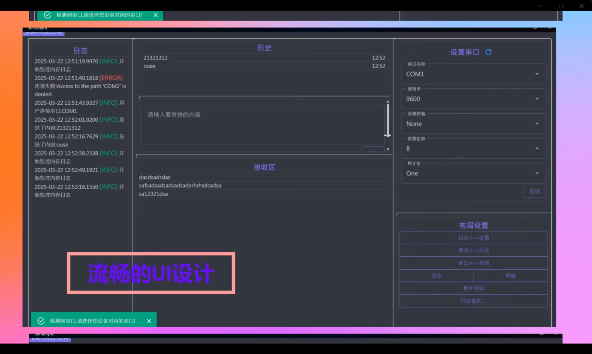
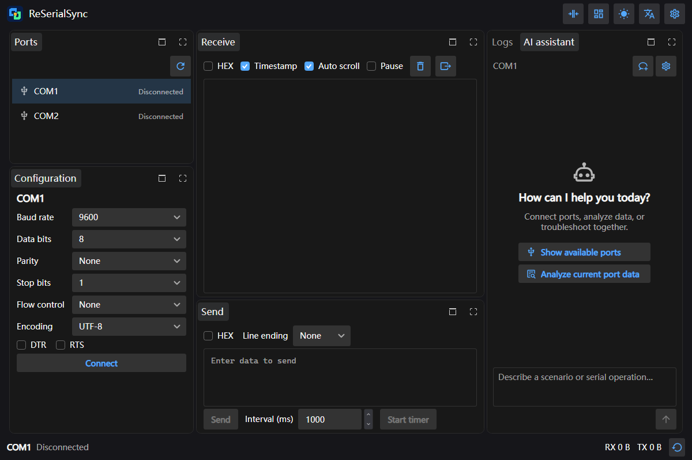
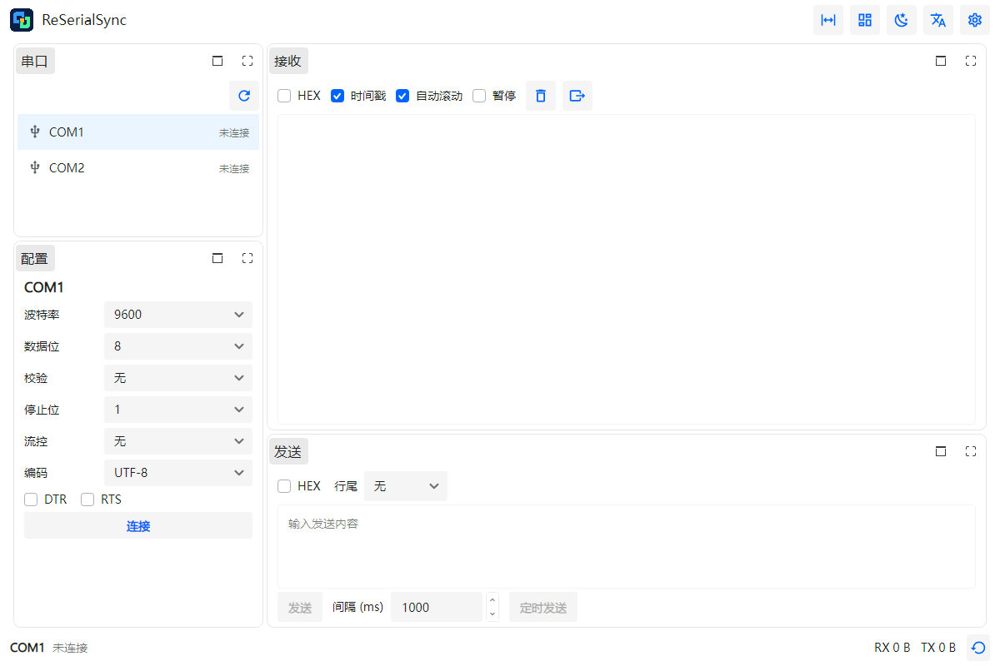
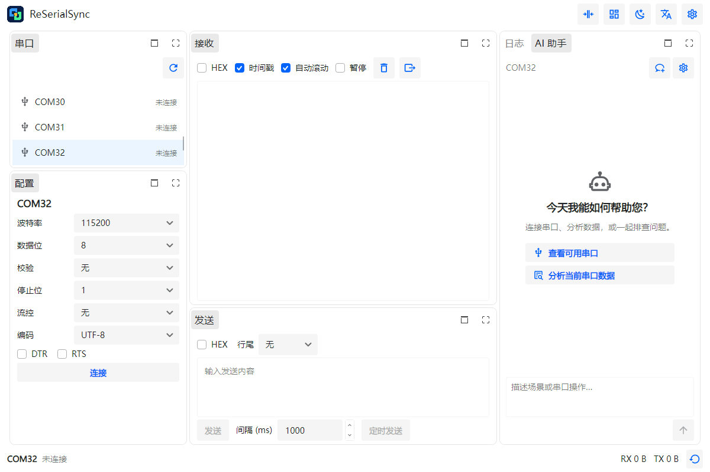
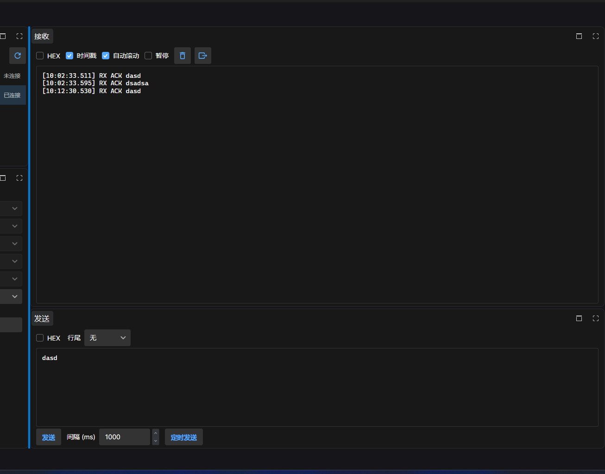
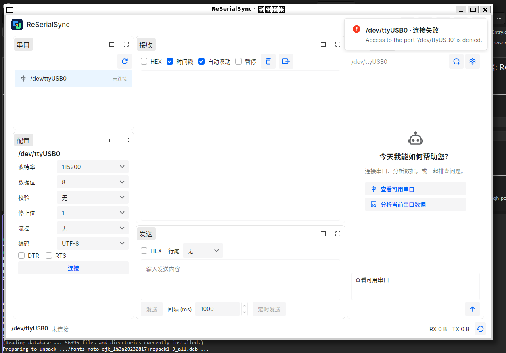

# SerialSync → ReSerialSync

## Before: SerialSync

The original application's demonstration is preserved in its [README](https://github.com/0use-TE/SerialSync#readme).
Source video: [SerialSync original demonstration](https://github.com/user-attachments/assets/2db47056-69de-41b8-9937-7bf6672397a3).

该图从作者旧仓库公开演示视频中提取，未重新绘制旧界面。

## After: ReSerialSync

These four images were captured from real Avalonia controls using Headless + Skia by the automated test suite
on October 8, 2026. Ports and AI responses in these tests are simulated. They demonstrate UI behaviour,
not physical-device communication or an external AI provider response.

## Physical-device / operating-system evidence

作者提供的 Windows 开发截图，接收区可见设备返回的 `ACK` 数据。
它没有单独证明所有串口功能都已在硬件上测试。

作者提供的 Linux AOT 实机环境截图，应用已启动并枚举 `/dev/ttyUSB0`，
但打开设备因权限被拒绝。该图用于说明迁移过程和 Linux 启动，不能作为 Linux 收发成功证据。
发布前仍需补充授权后的 Linux PING / PONG 成功截图。

## Personal story

[.NET Conf 2025 community photo](media/avalonia-community-2025.jpg) · [MatePad Edge giveaway prize](media/matepad-edge.jpg)

Community photos are contextual material, not evidence of platform support or endorsement of this entry.
Private emails, email addresses and licence invitations are not included.
